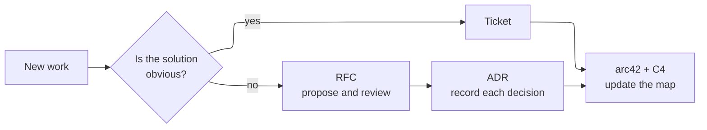

# Design docs template

Three documents, one rule: **separate what changes from what must not change.**

Reading view: [openmove.github.io/engineering-design-playbook](https://openmove.github.io/engineering-design-playbook/).

## The method in 30 seconds

Before you write anything, ask one question: *is this still being decided, already decided, or describing what exists?*

| You are… | Write | When | Can it change? |
|----------|-------|------|----------------|
| Still convincing people | **RFC** — a proposal | Before building | Yes, while in review. Then it is history. |
| Recording a choice | **ADR** — one decision | The moment you decide | Never. A new ADR supersedes it. |
| Describing the system today | **arc42** — the map | Continuously | Yes, always kept current. |

They form a chain. Skipping the last step is how documentation rots.



## Why

Without this split, every project hits the same three problems:

- **Nobody remembers why.** Six months in, the reason for a choice left with the person who made it. ADRs keep the reason next to the code.
- **The architecture doc is stale.** One big document is too expensive to keep current, so nobody does. arc42 splits it into sections, so you update only the one that changed.
- **The same debate happens twice.** Discussions buried in chat get repeated. An RFC keeps the proposal, the alternatives, and why they lost in one place.

## Three rules

1. **Never edit an accepted ADR.** It is a record of what was true when you decided, like a commit. If the decision changes, write a new ADR and mark the old one `superseded by ADR-NNNN`.
2. **Close the loop.** An implemented RFC is not documentation of the system. Update the arc42 section and the C4 diagram it touched, in the same change.
3. **Skip the RFC when the answer is obvious.** If there are no trade-offs, a ticket is enough. An RFC that only says "here is how we will build it" is overhead.

## See it on a real-looking project

**[CityCycle](https://openmove.github.io/design-docs-example/tour/)** — a fictional bike-sharing service, published beside this template. The tour walks the chain and names what each document buys you. Source: [openmove/design-docs-example](https://github.com/openmove/design-docs-example).

The example is a separate repository because **Use this template** copies every file. Keeping CityCycle in this repository would drop a fictional bike-sharing system into every new project.

## Start a project

```bash
gh repo create my-project --template openmove/engineering-design-playbook --private
```

Or choose **Use this template** on GitHub.

In [Cursor](https://cursor.com/), you can also run the **bootstrap** agent skill (see [Agent skills](#agent-skills) below).

On day one, fill only this. Leave the other arc42 sections empty until there is something real to write.

1. [Section 1](docs/architecture/01_introduction_and_goals.md) — goals, and the top three quality goals as measurable scenarios
2. [Section 3](docs/architecture/03_context_and_scope.md) and the [context diagram](docs/architecture/diagrams/c4-context.md) — who and what the system talks to
3. [Section 4](docs/architecture/04_solution_strategy.md) — half a page on how the design meets those goals
4. [Section 5](docs/architecture/05_building_block_view.md) and the [container diagram](docs/architecture/diagrams/c4-containers.md) — the deployable pieces
5. The first ADRs — stack, persistence, boundaries, deploy

## What is inside

```text
docs/
  architecture/   arc42 9.0, one file per section, plus C4 diagrams in Mermaid
  adr/            MADR 4.0 templates and ADR 0000 (we use MADR)
  rfc/            RFC template, full and mini
website/          Starlight site that renders docs/ for GitHub Pages
.cursor/skills/   Cursor agent skills for this docs workflow
.claude/skills/   Claude Code skills (same tree)
.agents/skills/   ChatGPT/Codex and Pi skills (same tree)
```

`docs/` is the source. Edit and review the Markdown there. `website/` only turns it into the reading view; to preview it locally, run `npm install` and `npm run dev` inside `website/`.

The arc42 and MADR files are the official upstream templates, copied in unchanged. Nothing here is a new format. See [NOTICES.md](NOTICES.md) for sources and licenses.

How each folder works: [architecture](docs/architecture/README.md) · [ADRs](docs/adr/README.md) · [RFCs](docs/rfc/README.md)

## Agent skills

**Install the skill once → run bootstrap → the docs repo scaffolds itself** (GitHub template + Starlight + these skills inside). You should not clone templates by hand just to get started.

Per-tool install (one `degit` line each) and the full command list: [skills README](.cursor/skills/design-docs-template/README.md) (same file under `.claude/skills/…` and `.agents/skills/…`).

This template already ships the skill for Cursor, Claude Code, ChatGPT/Codex, and Pi:

| Agent | Path |
| --- | --- |
| Cursor | [`.cursor/skills/design-docs-template/`](.cursor/skills/design-docs-template/) |
| Claude Code | [`.claude/skills/design-docs-template/`](.claude/skills/design-docs-template/) |
| ChatGPT / Codex / Pi | [`.agents/skills/design-docs-template/`](.agents/skills/design-docs-template/) |

| Command | What it does |
| --- | --- |
| **bootstrap** | Create a new docs repo from this GitHub template and rebrand site config. Skills land in the new repo automatically. |
| **new-rfc** | Next numbered RFC + index. |
| **new-adr** | Next numbered ADR (MADR) + index. |
| **rfc-hygiene** | Clean a noisy draft RFC (names, diagrams, examples). |
| **close-loop** | Approved RFC → ADR(s) + arc42/C4 checklist. |
| **preview** | Local Starlight; URL includes `base`. |

Typical path: **bootstrap** → **preview** → write → **new-rfc** → **rfc-hygiene** → **close-loop**.

## Further reading

- [arc42](https://arc42.org/overview/) and its [section docs](https://docs.arc42.org/)
- [MADR](https://adr.github.io/madr/)
- [Documenting Architecture Decisions](https://cognitect.com/blog/2011/11/15/documenting-architecture-decisions), Michael Nygard
- [The C4 model](https://c4model.com/)
- [Design docs at Google](https://www.industrialempathy.com/posts/design-docs-at-google/)
