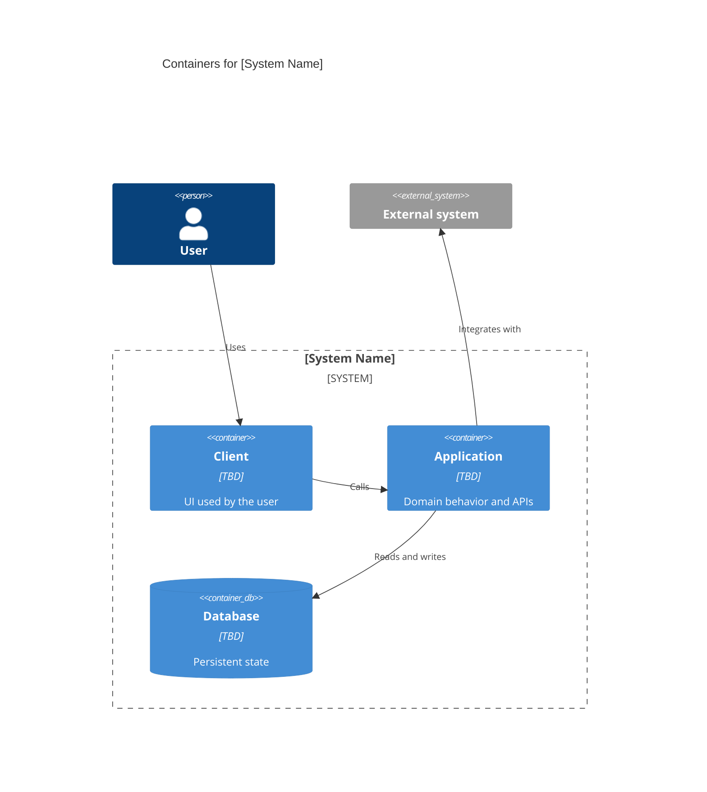
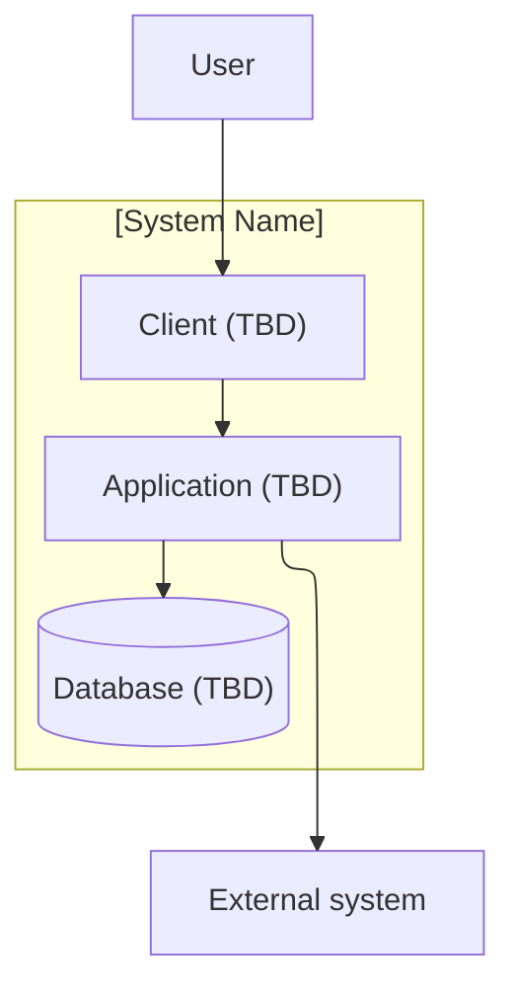

# C4 — Containers

A container is something you can deploy or run: an application, a datastore, a queue. Replace every TBD once an ADR chooses the technology. Do not invent containers here before that decision.

