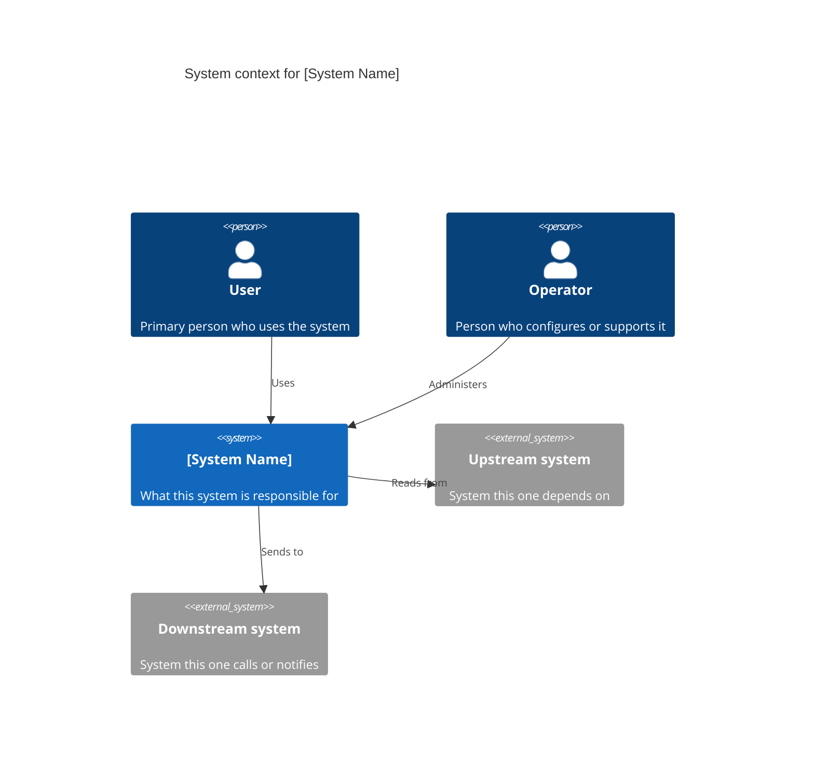
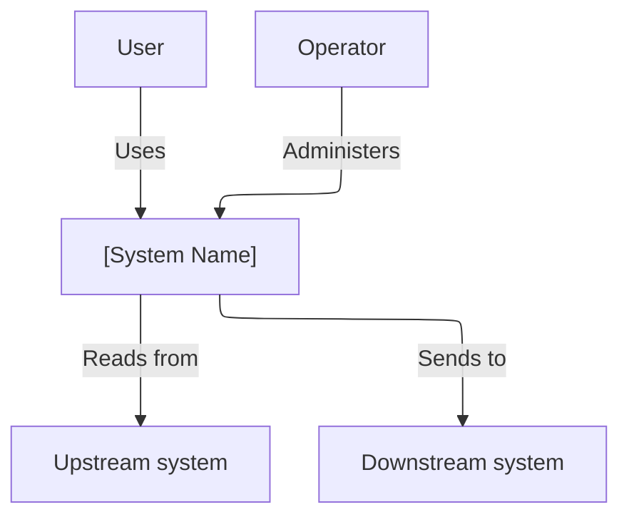

# C4 — System context

Replace the placeholder names. Keep one box for your system. Everything else is a person or an external system.

GitHub renders Mermaid. If a viewer does not support `C4Context`, use the flowchart below it. Same picture, plainer syntax.

